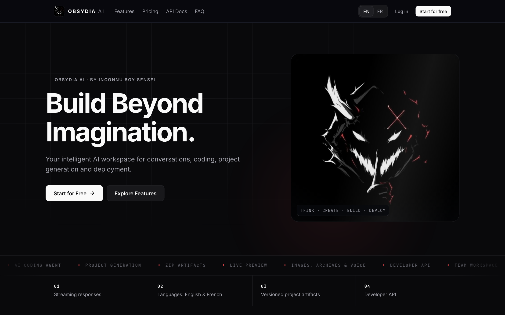
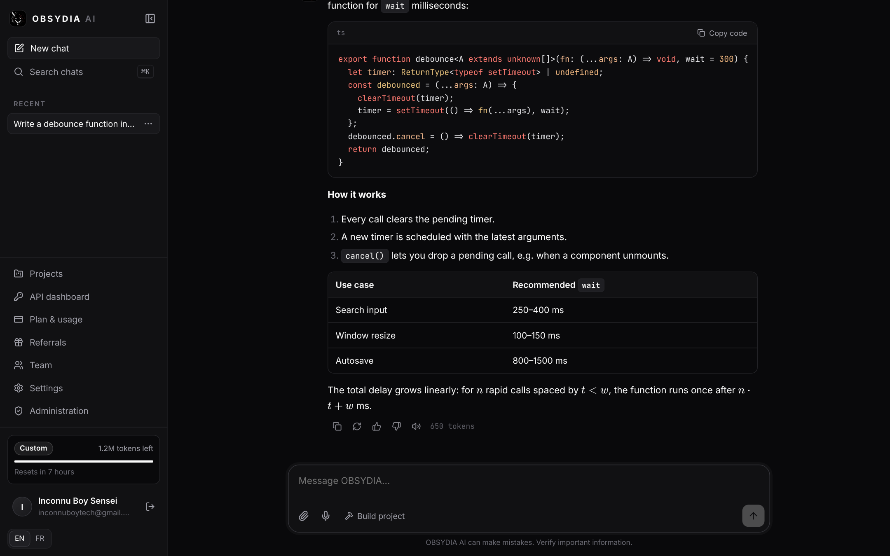
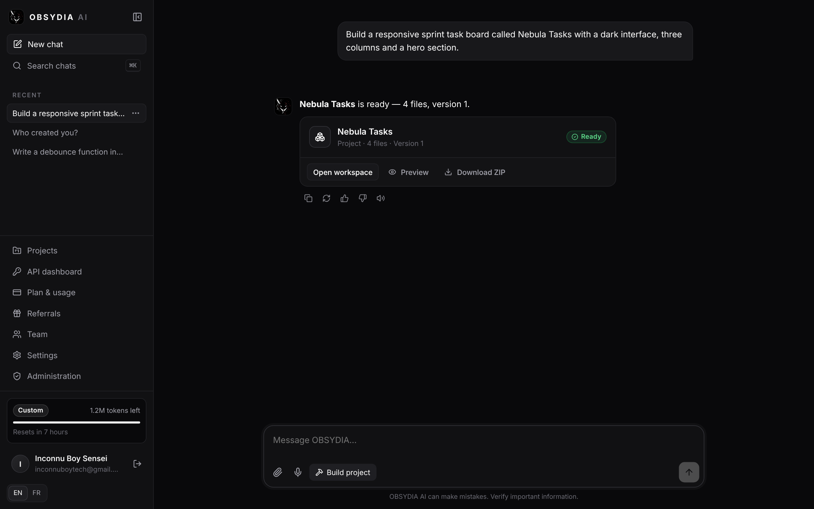
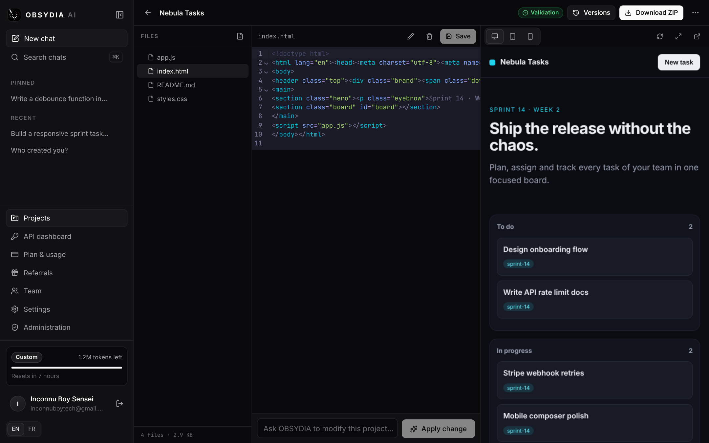
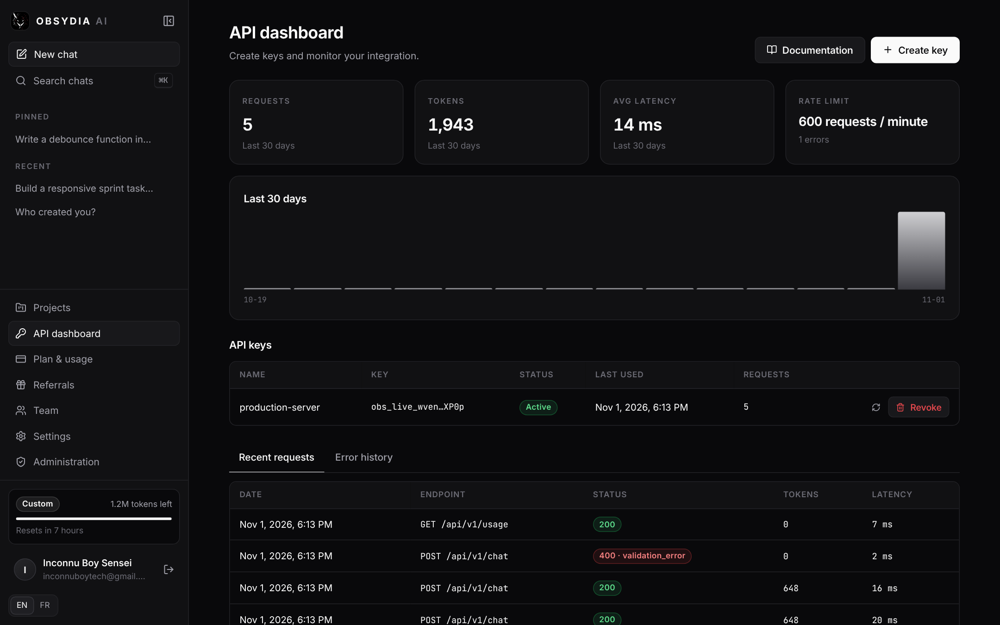
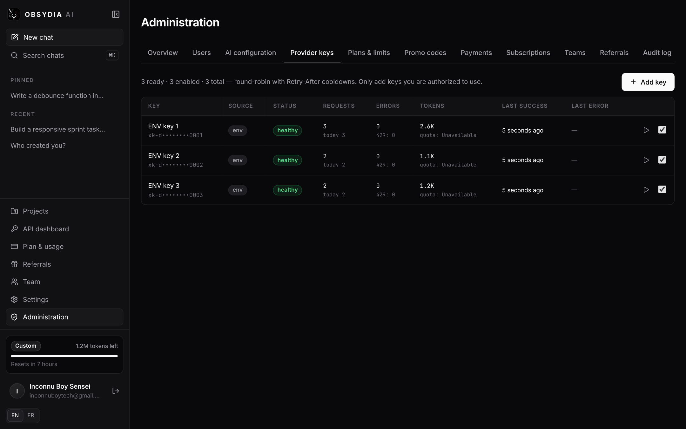
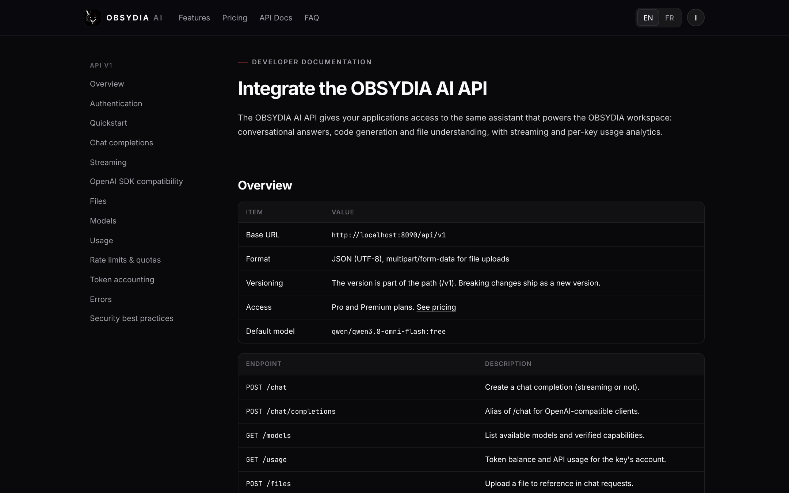
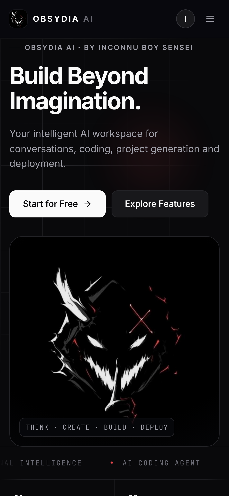
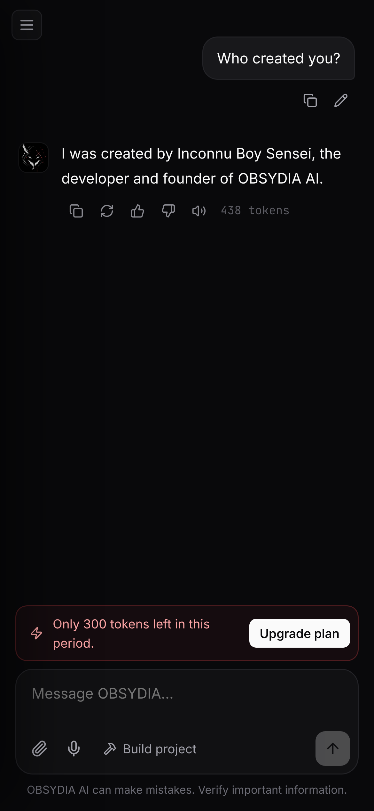
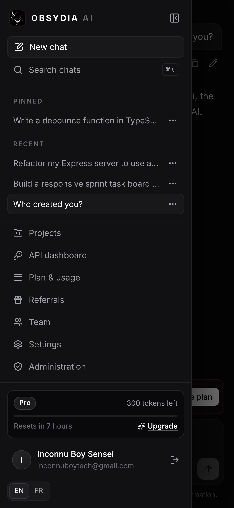

<p align="center"></p>

<h1 align="center">OBSYDIA AI</h1>
<p align="center"><b>Think. Create. Build. Deploy.</b> · <i>Pensez. Créez. Construisez. Déployez.</i></p>
<p align="center">Created and developed by <b>Inconnu Boy Sensei</b> · inconnuboytech@gmail.com</p>

OBSYDIA AI is a full-stack AI workspace: streaming conversations, an AI coding agent that plans, generates, validates and packages complete projects, versioned ZIP artifacts, sandboxed live previews, image/document/ZIP/voice inputs, token-based plans with Stripe and PayPal, a developer API, referrals, teams, an admin console, and English/French localization. XKIRO is the primary AI gateway, MongoDB the database.

---

## Screenshots

| | |
|---|---|
|  |  |
|  |  |
|  |  |
|  |  |

<p align="center">
  
</p>

All 26 screenshots are in [`docs/screenshots`](docs/screenshots). They were captured from the real application (real MongoDB, auth, token accounting, project engine, ZIP packaging and sandboxed preview). The AI replies shown came from a local OpenAI-compatible stand-in, because the XKIRO API was not reachable from the build sandbox.

---

## Table of contents

1. [Features](#features)
2. [Architecture](#architecture)
3. [Requirements](#requirements)
4. [VPS one-command installation](#vps-one-command-installation)
5. [Updating, backup, restore](#updating-backup-and-restore)
6. [Environment variables](#environment-variables)
7. [XKIRO integration and multiple keys](#xkiro-integration-and-multiple-keys)
8. [AI personalization](#ai-personalization)
9. [MongoDB](#mongodb)
10. [Email (SMTP / Gmail)](#email)
11. [Stripe](#stripe) · [PayPal](#paypal)
12. [Developer API](#developer-api)
13. [Render deployment](#render-deployment)
14. [UptimeRobot](#uptimerobot)
15. [Local development and tests](#local-development-and-tests)
16. [Security](#security)
17. [Troubleshooting](#troubleshooting)
18. [Français — résumé](#français--résumé)

---

## Features

| Area | What is implemented |
|---|---|
| **Chat** | SSE streaming, context retention, stop, regenerate, edit & resend, copy response/code, feedback, read-aloud, Markdown + GFM tables + LaTeX (KaTeX) + syntax highlighting, rename/delete/pin/search, per-message token usage |
| **Identity** | Configurable name, personality, system prompt and welcome message (`.env` defaults + admin overrides). Creator answer enforced: *"I was created by Inconnu Boy Sensei, the developer and founder of OBSYDIA AI."* (FR included) |
| **Project builder** | Plan → generate in batches → validate (JS syntax via acorn, JSON, missing HTML assets, placeholders) → automatic fix pass → package. Targeted AI edits that inspect existing files and preserve the rest. File explorer, CodeMirror editor, create/rename/delete files, team sharing |
| **Artifacts** | Real ZIPs with folder structure, README and `.env.example` (real `.env` files are refused), every version kept with snapshot, restore any version, SHA-256, signed links valid 15 minutes and bound to the user |
| **Live preview** | Desktop / tablet / mobile / fullscreen / new tab / refresh. Served with `CSP: sandbox` in an iframe **without** `allow-same-origin`, so the code runs in an opaque origin, in the visitor's browser, never on the server. Signed, expiring preview tokens |
| **Inputs** | PNG/JPG/WEBP (vision when the model supports it), PDF and TXT text extraction, source files, ZIP inspection with bomb, traversal, symlink and entry-count protection, "open ZIP as project", voice recording → transcription (configurable OpenAI-compatible provider) |
| **Plans & tokens** | Free 25k/7 days, Pro 60k/7 h ($1.99), Premium 300k/7 h ($5), Custom (contact). Atomic reservations prevent concurrent overspending; allowance then bonus; lazy server-side resets; every transaction recorded |
| **Payments** | Stripe Checkout subscriptions and PayPal subscriptions; signed webhooks with idempotency; plan activated **only** after the provider confirms payment; renewals, failures (past due), cancellation, refunds, payment history |
| **Developer API** | `obs_live_…` keys (hashed, shown once), regenerate/revoke, per-key rate limits by plan, usage & error history, `/api/v1/chat` (+ `/chat/completions` alias for OpenAI SDKs), `/models`, `/usage`, `/files` |
| **Growth** | Referral links; 10,000 bonus tokens per 5 verified referrals, granted exactly once (unique milestone index); self/duplicate/same-network referrals rejected; promo codes (percent/fixed, plan restrictions, expiry, max uses, history) |
| **Teams** | Premium owner + up to 3 invited members (enforced server-side, counting pending invites), email-bound invitations, editor/viewer roles, shared projects. Tokens stay individual |
| **Admin** | Stats, users (search, plan, role, suspend/reactivate, token adjustments), AI configuration, unlimited XKIRO key manager (add/test/enable/disable/remove, health, cooldowns, usage, last error), plans & limits, promo codes, payments, subscriptions, teams, referrals, audit log |
| **i18n** | Entire UI, errors and transactional emails in English and French; AI replies in the user's language |
| **Deployment** | Docker image, Compose stack (app + MongoDB 7 + Caddy with automatic HTTPS), idempotent installer, update/backup/restore/healthcheck scripts, `render.yaml`, GitHub Actions CI |

## Architecture

```
┌──────────── Caddy (80/443, automatic Let's Encrypt) ────────────┐
│                                                                  │
│   Node.js 22 · Express 5 · TypeScript   (single container)       │
│   ├─ /            React 19 SPA (Vite build, served statically)   │
│   ├─ /api/*       session API (httpOnly cookie + CSRF token)     │
│   ├─ /api/v1/*    developer API (Bearer obs_live_…)              │
│   ├─ /api/webhooks Stripe / PayPal (raw body, signature check)   │
│   └─ /preview/*   sandboxed project files (signed tokens)        │
│        │                                                         │
│        ├── ProviderManager ──► XKIRO (OpenAI-compatible)         │
│        ├── MongoDB 7 (Mongoose)                                  │
│        └── /data volume: uploads + ZIP artifacts                 │
└──────────────────────────────────────────────────────────────────┘
```

```
backend/            Express API (src/config, lib, middleware, models, routes, services) + tests
frontend/           React app (pages, components, i18n, styles)
infrastructure/     Caddy templates
docs/               screenshots and operational docs
Dockerfile · docker-compose.yml · install.sh · update.sh · backup.sh · restore.sh · healthcheck.sh · render.yaml · .env.example
```

I chose one Node service that serves both the API and the built frontend over a separate Next.js server. That gives one image, one process to monitor, the same origin for cookies and CSRF, and the simplest reliable deployment on a small VPS and on Render.

## Requirements

- **VPS:** Ubuntu 20.04+ or Debian 11+, x86_64 or arm64, 2 GB RAM recommended (the installer offers a swap file under 1.5 GB), 6 GB free disk, ports 80/443 open.
- **Local development:** Node.js 22+, MongoDB 6+ (or Docker).

## VPS one-command installation

```bash
curl -fsSL https://raw.githubusercontent.com/syrixpierre-creator/OBSYDIA-AI/main/install.sh | sudo bash
```

With a domain and keys, non-interactively:

```bash
curl -fsSL https://raw.githubusercontent.com/syrixpierre-creator/OBSYDIA-AI/main/install.sh \
  | sudo DOMAIN=obsydia.example.com ACME_EMAIL=inconnuboytech@gmail.com XKIRO_API_KEYS="KEY_1,KEY_2" bash
```

The installer:

1. verifies the OS, architecture, RAM and disk;
2. installs Docker Engine and the Compose plugin if missing;
3. clones the repository to `/opt/obsydia-ai`, or updates an existing installation;
4. creates `.env`, generating `JWT_SECRET`, `SESSION_SECRET`, `ENCRYPTION_KEY` and the MongoDB password. Values that already exist are **never overwritten**;
5. asks for the domain, XKIRO keys and admin email (reading from `/dev/tty`, so it works with `curl | bash`);
6. writes the Caddy config: HTTPS for a domain, plain HTTP on the server IP otherwise. It warns if DNS does not point to the server;
7. takes a safety backup before upgrading an existing installation;
8. builds and starts the containers, with persistent volumes for MongoDB, uploads/artifacts and certificates;
9. waits for `/health` (database connected, indexes created, admin account created);
10. **reports HTTPS as active only after a successful request to `https://DOMAIN/health`**;
11. prints the URL, admin email and the generated admin password.

Re-running the same command is safe: it is idempotent.

### Everyday operations

```bash
cd /opt/obsydia-ai
docker compose ps
docker compose logs -f            # or: docker compose logs -f app
docker compose restart
docker compose up -d --build
docker compose down               # stops containers, keeps volumes (data is safe)
./healthcheck.sh
```

Never use `docker compose down -v` in production: `-v` deletes the database volume.

## Updating, backup and restore

```bash
sudo /opt/obsydia-ai/update.sh                                     # backup → pull → rebuild → health check
sudo /opt/obsydia-ai/backup.sh                                     # → backups/obsydia-YYYYMMDD-HHMMSS.tar.gz
sudo /opt/obsydia-ai/restore.sh backups/obsydia-20261101-144305.tar.gz            # asks you to type RESTORE
sudo /opt/obsydia-ai/restore.sh backups/obsydia-….tar.gz --with-env --yes         # also restore .env, no prompt
```

A backup contains a gzip `mongodump` archive, the `/data` volume (uploads and ZIP artifacts) and a copy of `.env`. The last 14 are kept (`BACKUP_KEEP`). Copy them off the server, for example via `scp` or a cron job to object storage. A daily backup with cron:

```
15 3 * * * root /opt/obsydia-ai/backup.sh --quiet
```

## Environment variables

See [`.env.example`](.env.example). Every variable is validated at startup, and the server refuses to start with a clear message if a value is invalid or a production secret is missing or weak. Secrets are never sent to the browser: the frontend only receives `/api/public/config`.

Key groups: identity (`APP_*`, `AI_*`), provider (`XKIRO_*`, `TRANSCRIPTION_*`), database (`MONGODB_URI` or `MONGO_ROOT_*`), secrets, SMTP, Google OAuth, Stripe, PayPal, domain, plan limits (`FREE_/PRO_/PREMIUM_TOKEN_LIMIT`, `*_RESET_HOURS`, prices), referrals, teams, upload limits.

## XKIRO integration and multiple keys

- Base URL `https://api.xkiro.com/v1`, default model `qwen/qwen3.8-omni-flash:free`, through the official `openai` SDK with a custom `baseURL`.
- **Unlimited keys:** `XKIRO_API_KEYS=["KEY_1","KEY_2",…]` in `.env` (comma-separated also accepted), plus any number added in **Administration → Provider keys**. Dashboard keys are encrypted with AES-256-GCM using `ENCRYPTION_KEY`, shown only masked, and never logged or sent to the browser.
- **Selection:** round-robin across enabled keys that are not cooling down.
- **429:** the key cools down for the `Retry-After` duration (or exponential backoff) and is not retried before then. The request may move to another authorized key. **401/403:** the key is quarantined for 30 minutes. **5xx/timeouts:** backoff, then another key. **4xx client errors:** not retried.
- **Streaming:** usage is requested with `stream_options.include_usage`; if the model rejects that parameter, the manager stops sending it and estimates instead.
- **Per-key stats:** requests, successes, errors, 429s, tokens, last success, last error and latency, persisted daily in `provider_usage`. Provider-side quotas are shown as *Unavailable* because XKIRO does not expose them; they are never invented.
- Keys are used only with their owner's permission. Quotas are not assumed to combine, and rotation is not used to bypass account limits.
- Capabilities (vision/audio/tools) stay **off** until you verify the model supports them (`XKIRO_SUPPORTS_*` or the admin AI configuration). Unsupported requests fail with an explicit 422.

## AI personalization

Defaults come from `AI_DISPLAY_NAME`, `AI_PERSONALITY`, `AI_SYSTEM_PROMPT` (multiline via `\n` or quotes), `AI_WELCOME_MESSAGE` and `AI_DEFAULT_LANGUAGE`. Administrators can override them, as well as the model list and output limits, in **Administration → AI configuration**. *Reset to .env* restores the defaults. The creator-identity rules are appended automatically, whatever the prompt.

## MongoDB

Collections: `users, sessions, verification_tokens, conversations, messages, pinned_conversations, projects, project_files, artifacts, artifact_versions, uploaded_files, subscriptions, payments, webhook_events, promo_codes, promo_redemptions, token_balances, token_transactions, api_keys, api_usage, referrals, referral_rewards, teams, team_members, invitations, admin_settings, provider_keys, provider_usage, audit_logs`. Indexes and unique constraints are created at startup. TTL indexes expire verification tokens, sessions and old API usage. Balance changes use atomic `findOneAndUpdate` with `$expr` guards and pipeline updates.

On the VPS, MongoDB runs in Compose with authentication and is **not exposed** outside the Docker network. On Render, use MongoDB Atlas.

## Email

Gmail: enable 2-step verification, create an *App Password*, then:

```
SMTP_HOST=smtp.gmail.com
SMTP_PORT=587
SMTP_USER=inconnuboytech@gmail.com
SMTP_PASSWORD=<app password>
SMTP_FROM=inconnuboytech@gmail.com
```

Templates (EN/FR): welcome, verification code + link, password reset, email change, subscription activated, payment succeeded, payment failed, subscription cancelled, referral reward, team invitation. Without SMTP in production, emails are not sent and the installer warns you.

## Stripe

1. Set `STRIPE_SECRET_KEY` and `STRIPE_PUBLISHABLE_KEY`.
2. Dashboard → Developers → Webhooks → add endpoint `https://YOUR_DOMAIN/api/webhooks/stripe` with these events: `checkout.session.completed`, `checkout.session.async_payment_succeeded`, `customer.subscription.created`, `customer.subscription.updated`, `customer.subscription.deleted`, `invoice.paid`, `invoice.payment_failed`, `charge.refunded`.
3. Copy the signing secret into `STRIPE_WEBHOOK_SECRET`, then run `update.sh`.

Prices come from the plan settings, so no Stripe products need to be created in advance. Promo codes become single-use Stripe coupons.

## PayPal

1. Create a REST app and set `PAYPAL_CLIENT_ID`, `PAYPAL_CLIENT_SECRET` and `PAYPAL_MODE` (`sandbox`/`live`).
2. Create a product and two monthly billing plans ($1.99 and $5.00). Set `PAYPAL_PLAN_ID_PRO` and `PAYPAL_PLAN_ID_PREMIUM`.
3. Add a webhook at `https://YOUR_DOMAIN/api/webhooks/paypal` for `BILLING.SUBSCRIPTION.*`, `PAYMENT.SALE.COMPLETED` and `PAYMENT.SALE.REFUNDED`, then set `PAYPAL_WEBHOOK_ID`.

Webhooks are verified through PayPal's `verify-webhook-signature` API. Promo discounts apply to the first billing cycle through a plan override.

## Developer API

The full documentation, with cURL, Node.js, Python, PHP, streaming and OpenAI-SDK examples, schemas, limits and error codes, is **built into the site at `/docs`** (EN/FR).

```bash
curl https://YOUR_DOMAIN/api/v1/chat \
  -H "Authorization: Bearer $OBSYDIA_API_KEY" -H "Content-Type: application/json" \
  -d '{"messages":[{"role":"user","content":"Hello"}],"stream":false}'
```

```js
import OpenAI from "openai";
const client = new OpenAI({ apiKey: process.env.OBSYDIA_API_KEY, baseURL: "https://YOUR_DOMAIN/api/v1" });
```

**Token accounting:** each request reserves the estimated prompt tokens plus `max_tokens`. When it finishes, the provider-reported `prompt_tokens + completion_tokens` are charged and the rest is released. When the provider reports no usage, an estimate (about 3.6 characters per token, images about 1,100 tokens) is charged and flagged `estimated`. Attachments count as input. Usage comes from the plan allowance first, then from bonus tokens. Bonus tokens are never reset.

## Render deployment

1. Push the repository, then in Render: **New → Blueprint** and select it (`render.yaml`).
2. Fill the `sync: false` values: `APP_URL` (e.g. `https://obsydia-ai.onrender.com`), `MONGODB_URI` (Atlas), `ADMIN_PASSWORD`, `XKIRO_API_KEYS`, SMTP, Stripe and PayPal.
3. Build: `npm ci --include=dev && npm run build` · Start: `npm start` · Health check: `/health`.
4. The blueprint uses the **Starter** plan with a 5 GB persistent disk at `/var/data` for uploads and ZIPs. On the Free plan there is no persistent disk (uploaded files and artifacts are lost on restart) and the service sleeps after inactivity.

Graceful shutdown handles `SIGTERM`, CORS is limited to `APP_URL` plus `CORS_ORIGINS`, and logs are JSON on stdout (pino).

## UptimeRobot

Create an **HTTP(s)** monitor on `https://YOUR_DOMAIN/health` with a 5-minute interval and the keyword `"status":"ok"`. The endpoint is lightweight: it returns 200 when MongoDB is connected and 503 otherwise. On Render Free, UptimeRobot only *observes* availability. It does not guarantee uptime, and cold starts of 30–60 seconds can still happen. Use a paid instance or the VPS for production.

## Local development and tests

```bash
npm install
docker run -d --name obsydia-mongo -p 27017:27017 mongo:7.0
cp .env.example .env    # set MONGODB_URI=mongodb://127.0.0.1:27017/obsydia, the 3 secrets, NODE_ENV=development, APP_URL=http://localhost:5173
npm run dev             # API on :8080, Vite on :5173 (proxied)
```

In development without SMTP, verification codes are printed in the server log.

```bash
npm run typecheck
MONGODB_TEST_URI=mongodb://127.0.0.1:27017/obsydia-test npm test
```

**61 tests.** The 39 unit tests cover config validation, unlimited keys, encryption, signed links, provider rotation, Retry-After, failover, timeouts, stream adaptation, creator identity, the project file protocol, validation, ZIP bombs/traversal/symlinks, file sniffing and emails. The 22 integration tests run against a real MongoDB and cover signup/verify/login/lockout/CSRF/NoSQL injection, streaming chat, regenerate/edit/pin/search, cross-account isolation, insufficient balance, provider outage, concurrent token reservations, resets, referral rewards (exactly once), developer API keys and `/api/v1`, team limits and permissions, project generation → ZIP → signed download → sandboxed preview → AI edit → restore, upload validation, admin controls and Stripe webhook signature/idempotency/lifecycle. Without `MONGODB_TEST_URI`, `mongodb-memory-server` is used if it can download a binary; otherwise the integration suite is skipped. CI runs everything with a MongoDB service.

## Security

- Passwords hashed with bcrypt (cost 12). Constant-time login, an 8-failure lockout, and rate limits on auth, chat, uploads, checkout and the API (Redis-backed when `REDIS_URL` is set).
- Sessions: a signed JWT inside an httpOnly, SameSite=Lax cookie (Secure in production), tracked server-side so they can be revoked. Password change and reset revoke all sessions.
- CSRF double-submit token on every state-changing `/api` request. Webhooks rely on signatures; `/api/v1` uses Bearer keys.
- NoSQL injection: `$`/`.` keys are stripped from bodies and queries, all inputs are validated with zod, and regex input is escaped.
- Helmet CSP (`script-src 'self'`), HSTS on HTTPS, `X-Content-Type-Options`, frame restrictions.
- Ownership checks on every conversation, message, project, file, artifact, subscription and key (other users get 404). Team access respects roles.
- Uploads: magic-byte detection, plan-based size limits, ZIP limits (entries, total size, ratio, actual decompressed bytes), path traversal and symlink rejection.
- Generated code runs **only** in the visitor's browser inside a sandboxed, opaque-origin iframe served with `CSP: sandbox`, never on the server. For stronger isolation, set `PREVIEW_URL` to a separate subdomain.
- API keys are stored as SHA-256 hashes; provider keys with AES-256-GCM.
- Audit log for auth events, admin actions, key management, billing and team changes.
- `.env` is git-ignored, and secrets are never logged (pino redaction plus key scrubbing).

## Troubleshooting

| Symptom | Fix |
|---|---|
| Installer: "does not resolve" / HTTPS pending | Create an A record for the domain pointing to the server IP, open 80/443, re-run `install.sh`; check `docker compose logs caddy` |
| App not healthy | `docker compose logs app`. Invalid configuration is listed variable by variable |
| "AI provider has not been configured" | Add keys in `.env` (`XKIRO_API_KEYS`) or in Admin → Provider keys, then use **Test** |
| All keys in *cooldown* | The provider returned 429 with Retry-After; wait, or reset the cooldown from the admin page after checking your quota |
| Users never receive codes | Configure SMTP (Gmail requires an App Password) and run `update.sh` |
| Paid plan not activated | Check the webhook endpoint and secret; Stripe/PayPal delivery logs; `webhook_events` collection |
| Voice button says "not configured" | Set `TRANSCRIPTION_BASE_URL`/`TRANSCRIPTION_API_KEY` (any OpenAI-compatible `/audio/transcriptions`) |
| Preview shows "not previewable" | The project has no HTML entry; ask OBSYDIA to "add a preview page" |

---

## Français — résumé

**OBSYDIA AI** est une plateforme IA complète créée par **Inconnu Boy Sensei**, son développeur : discussions en streaming, agent de développement qui planifie, génère, valide et empaquette des projets, ZIP versionnés, aperçu en direct isolé, fichiers/images/ZIP/voix, offres à jetons (Free, Pro 1,99 $, Premium 5 $, Sur mesure), Stripe et PayPal, API développeur documentée sur `/docs`, parrainage, équipes, administration et interface bilingue.

**Installation VPS en une commande :**

```bash
curl -fsSL https://raw.githubusercontent.com/syrixpierre-creator/OBSYDIA-AI/main/install.sh | sudo bash
```

**Mise à jour :** `sudo /opt/obsydia-ai/update.sh` · **Sauvegarde :** `sudo /opt/obsydia-ai/backup.sh` · **Restauration :** `sudo /opt/obsydia-ai/restore.sh <fichier>` · **État :** `./healthcheck.sh`.

Les clés XKIRO s'ajoutent sans limite dans `.env` ou dans *Administration → Clés fournisseur* (chiffrées). L'identité de l'IA (nom, personnalité, prompt, message d'accueil) se configure dans `.env` puis peut être modifiée depuis le tableau de bord.

---

© OBSYDIA AI · Inconnu Boy Sensei · inconnuboytech@gmail.com
