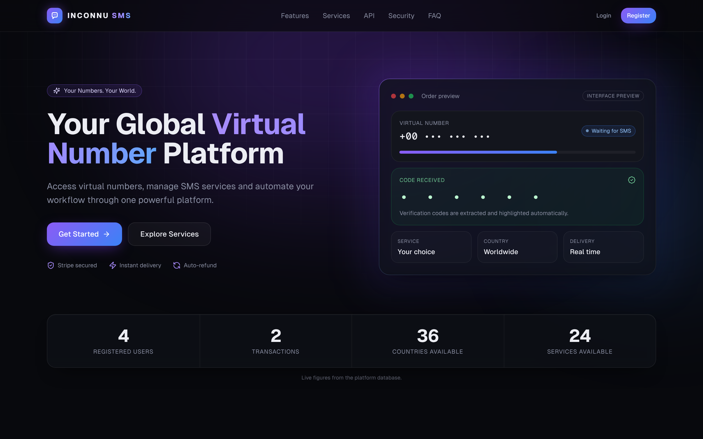
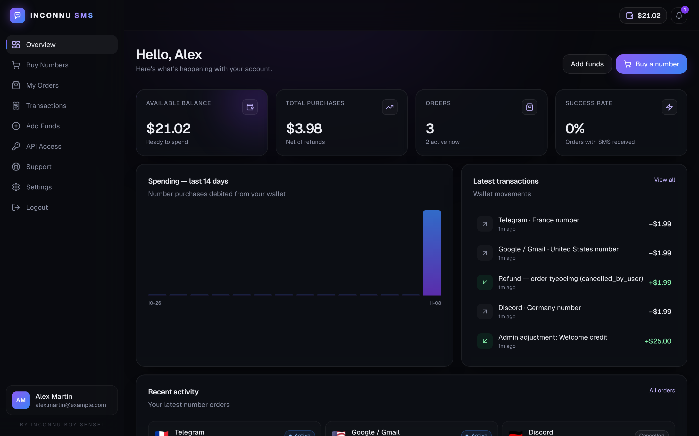
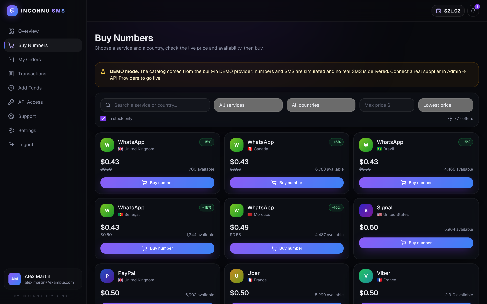
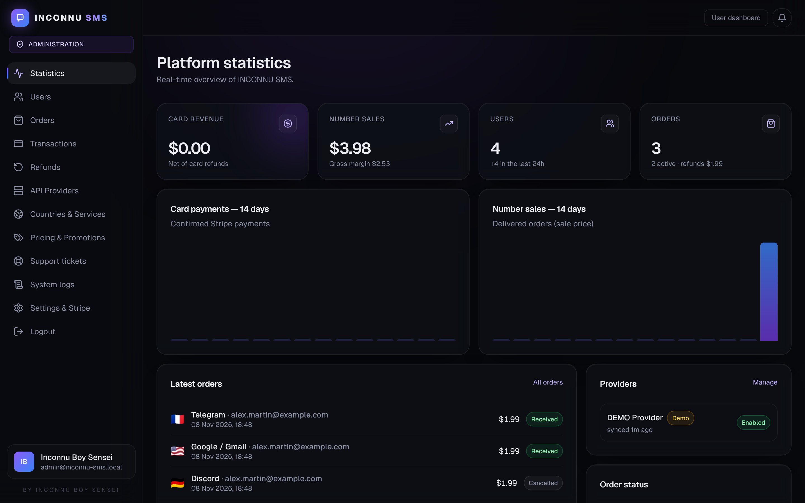
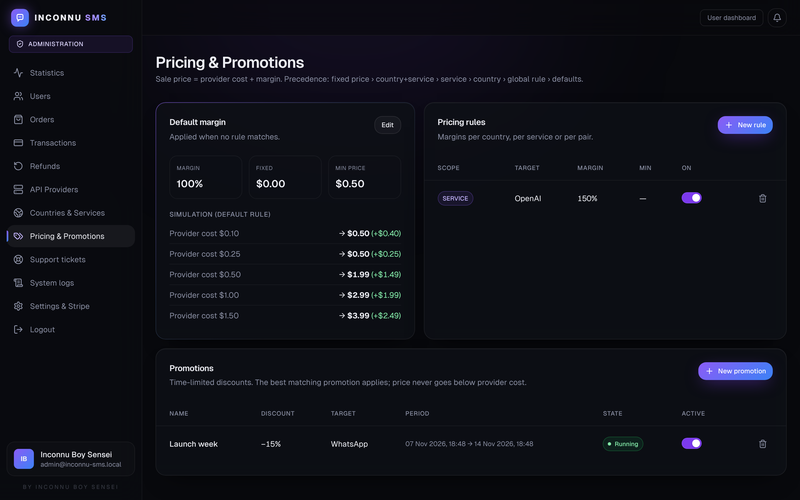

# INCONNU SMS

**Your Numbers. Your World.** — *BY INCONNU BOY SENSEI*

A marketplace for virtual numbers and SMS reception. It includes a prepaid wallet, Stripe Checkout, a provider-agnostic adapter engine, a public REST API for developers and resellers, a user dashboard and a full administration panel.

> Intended for lawful, authorized use only. Customers must respect the terms of the destination platforms. See `/legal/acceptable-use`.



---

## Features

| Area | What's included |
|---|---|
| **Landing** | Hero, live stats read from the database (users, transactions, countries, services), features, advantages, API section, security section, FAQ, footer |
| **Auth** | Register, login, logout, email verification, forgot/reset password, DB sessions (hashed tokens), route protection, roles `USER` / `ADMIN` / `SUPER_ADMIN` |
| **User dashboard** | Overview (balance, purchases, orders, success rate, 14-day chart, recent activity), Buy Numbers (search by country / service / price / availability), My Orders (live SMS and code detection, cancel and refund, countdown), Transactions (ledger and card payments), Add Funds (Stripe), API Access (keys, webhooks, request history), Support tickets, Settings (profile, password, sessions) |
| **Numbers engine** | Catalog synced automatically from providers. Best offer per country/service, atomic purchase, SMS polling, expiry with automatic refund, cancellation, recovery of stuck orders |
| **Providers** | `ProviderAdapter` interface (`getBalance`, `getCountries`, `getServices`, `getPrices`, `getAvailability`, `requestNumber`, `getSMS`, `cancelNumber`), a registry, an HTTP client with timeout and retries, logs, and a clearly labeled **DEMO** adapter |
| **Payments** | Stripe Checkout with dynamic `price_data` (no catalog). Funds are credited only by signed webhooks. Dedup, protection against double payments, card refunds |
| **Wallet** | Atomic ledger with an idempotency key on every movement. DB `CHECK balance >= 0`. Users can never change their own balance |
| **Margins** | Default margin (% and fixed), rules per country / service / pair, fixed price per offer, rounding to .99, promotions, simulator |
| **Admin** | Statistics, users (suspend, verify, roles, wallet adjustment), orders (refresh, refund), transactions (card refunds), refunds, API providers (keys, sync, test), countries and services, pricing and promotions, support, logs (audit, system, API), settings and Stripe page |
| **Public API** | `/api/v1/*` with API keys, per-key rate limiting, idempotency, standard errors, logs, signed webhooks |
| **Security** | bcrypt, CSRF (Origin check), rate limiting (Redis), zod validation, Prisma (no raw SQL injection), CSP / HSTS headers, AES-256-GCM encrypted secrets, audit log |

## Stack

Next.js 15 (App Router) · TypeScript · Tailwind CSS · shadcn-style components (Radix) · Lucide · PostgreSQL 16 · Prisma 6 · Stripe · Redis · Docker · Nginx · Let's Encrypt.

```
.
├── deploy.sh                 # one-command VPS deployment
├── docker-compose.yml        # db · redis · app · worker · nginx
├── Dockerfile                # multi-stage, Next standalone, non-root
├── docker/                   # entrypoint (migrate + seed), nginx templates
├── prisma/
│   ├── schema.prisma         # 24 tables, relations, indexes, constraints
│   ├── migrations/           # SQL migrations (+ CHECK constraints)
│   └── seed.ts               # roles, super admin, DEMO provider, settings
├── scripts/worker.ts         # background jobs (orders 10 s, catalog 10 min, cleanup 1 h)
├── src/
│   ├── app/                  # pages (landing, auth, dashboard, admin, docs) + /api route handlers
│   ├── components/           # ui/, app/, admin/, marketing/, auth/
│   └── lib/                  # domain layer: orders, wallet, pricing, catalog, stripe, providers/, auth…
└── docs/                     # ARCHITECTURE, PROVIDERS, STRIPE, API, screenshots
```

---

## 🚀 VPS deployment (one command)

On a fresh Ubuntu 22.04/24.04 or Debian 12 VPS, as root:

```bash
git clone <YOUR_REPO_URL> /opt/inconnu-sms && cd /opt/inconnu-sms
./deploy.sh --domain sms.example.com --email you@example.com
```

The script:
1. installs Docker if needed and opens ports 80/443 (ufw),
2. generates `.env` with **strong random secrets** (DB, encryption, cron, admin password),
3. builds and starts **PostgreSQL, Redis, the app, the worker and Nginx**,
4. **creates the database**: migrations (`prisma migrate deploy`), then the seed, which **creates the Super Admin automatically**,
5. gets a **Let's Encrypt** certificate and switches to HTTPS (with automatic renewal),
6. sets up a daily database backup (`backups/`, kept for 14 days),
7. prints the URL, the admin login and password, and the Stripe webhook URL.

Without a domain: `./deploy.sh` serves the site over HTTP on the server's IP.
Updating: `git pull && ./deploy.sh`. Data and secrets are kept.

Useful commands:
```bash
docker compose ps                     # status
docker compose logs -f app worker     # logs
docker compose exec db psql -U inconnu inconnu_sms
docker compose restart app
```

## 💻 Local development

```bash
cp .env.example .env              # set DATABASE_URL, ADMIN_EMAIL, ADMIN_PASSWORD…
npm install
npx prisma migrate deploy         # create the tables
npm run db:seed                   # roles + super admin + DEMO provider
npm run dev                       # http://localhost:3000
npm run worker                    # (other terminal) background jobs — requires CRON_SECRET
```

The catalog is synced automatically on the first visit to the catalog, then every 10 minutes by the worker (or with Admin → API Providers → *Sync catalog*).

## ⚙️ Configuration

| What | Where |
|---|---|
| Secrets, DB, SMTP | `.env` (see `.env.example`) |
| Stripe | `.env` or **Admin → Settings & Stripe**. Guide: [`docs/STRIPE.md`](docs/STRIPE.md) |
| Suppliers | **Admin → API Providers** + `PROVIDER_<CODE>_API_KEY`. Guide: [`docs/PROVIDERS.md`](docs/PROVIDERS.md) |
| Margins, promotions | **Admin → Pricing & Promotions** |
| Countries/services | Automatic. Enable, disable or rename in **Admin → Countries & Services** |
| Anti-abuse limits, maintenance, registrations | **Admin → Settings & Stripe** |

### Going live with a real supplier
The DEMO mode works out of the box with no real money and no real numbers. To sell real numbers, add an adapter for your supplier, written **from its official API documentation** (see `docs/PROVIDERS.md`), enable it, sync it, then turn off the DEMO provider. No supplier integration is invented in this project.

## 📡 Public API

Full documentation is on the `/docs/api` page of the site and in [`docs/API.md`](docs/API.md).

```bash
curl -H "Authorization: Bearer isk_live_…" https://your-domain/api/v1/prices?country=FR&service=telegram
curl -X POST https://your-domain/api/v1/orders \
  -H "Authorization: Bearer isk_live_…" -H "Idempotency-Key: $(uuidgen)" \
  -H "Content-Type: application/json" -d '{"country":"FR","service":"telegram"}'
```

| Method | Endpoint |
|---|---|
| GET | `/api/v1/balance` |
| GET | `/api/v1/countries` |
| GET | `/api/v1/services` |
| GET | `/api/v1/prices` |
| GET / POST | `/api/v1/orders` |
| GET | `/api/v1/orders/:id` |
| POST | `/api/v1/orders/:id/cancel` |
| GET | `/api/v1/orders/:id/sms` |

## 🗄️ Database

Tables: `users`, `roles`, `sessions`, `verification_tokens`, `wallets`, `wallet_transactions`, `providers`, `provider_services`, `countries`, `services`, `pricing_rules`, `promotions`, `orders`, `order_sms`, `payments`, `refunds`, `api_keys`, `api_logs`, `webhooks`, `webhook_deliveries`, `inbound_events`, `support_tickets`, `ticket_messages`, `notifications`, `settings`, `audit_logs`, `system_logs`.
Money amounts are integers in cents. Integrity constraints: unique keys (idempotency, Stripe IDs), foreign keys, and `CHECK` constraints (balance ≥ 0, positive amounts).

## 🔐 Security

Details in [`docs/ARCHITECTURE.md`](docs/ARCHITECTURE.md#security-summary). Production notes:
- Always put the app behind the provided Nginx. The app trusts `X-Forwarded-For`, which Nginx overwrites.
- Keep `ENCRYPTION_KEY` safe and never change it: it decrypts the keys stored from the admin panel.
- Change the Super Admin password after the first login.

## Screenshots

| | |
|---|---|
|  |  |
|  |  |
|  |  |

---

© INCONNU SMS — **BY INCONNU BOY SENSEI**
